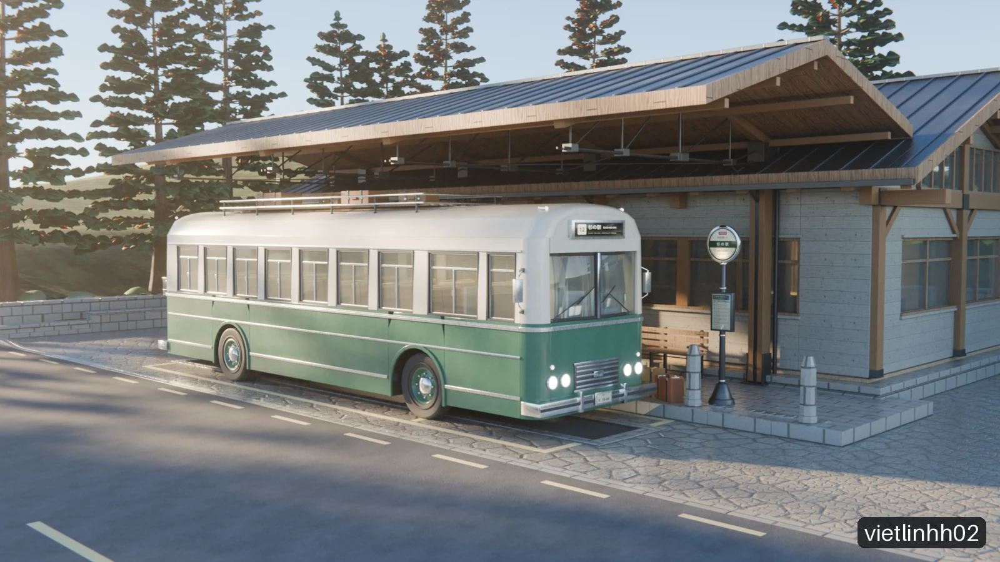

# Blender Agent Skills

Build game-ready assets, modular levels, and architectural scenes in Blender from an agent session.

[Install](#install-in-a-project) · [See the results](#previews) · [Copy a prompt](docs/prompts/README.md) · [Read the bus trace](docs/case-studies/sugi-no-eki/README.md#token-breakdown)

## Install in a project

From your project folder, run this and choose the skills and agent you want. The installer pulls the skills directly from this GitHub repo.

```sh
npx skills add vietlinhh02/blender-agent-skills
```

Install all three skills for **Antigravity CLI (AGY)** in one step:

```sh
npx skills add vietlinhh02/blender-agent-skills --skill "*" --agent antigravity-cli -y
```

Use **Node.js 22.20 or later** for the installer. Open a new agent session in your project after installing. To build a scene, give your agent access to Blender through the shell or a compatible Blender integration.

<details>
<summary>Install a single skill, target another agent, or install manually</summary>

```sh
npx skills add vietlinhh02/blender-agent-skills --list
npx skills add vietlinhh02/blender-agent-skills --skill blender-game-assets --agent codex
```

Use `claude-code`, `gemini-cli`, or `antigravity-cli` in place of `codex` to choose another client. Add `-g` to install for your user across projects. Install all three if you want the architecture workflow and prompt builder to find their sibling skills.

For manual installation, copy your selections from [skills/](skills/) into `.agents/skills/` for AGY, Codex, or Gemini CLI, or `.claude/skills/` for Claude Code. Keep each skill's folder and resources together.

[Installer documentation](https://github.com/vercel-labs/skills)

</details>

## Previews

| Stylized game workshop | Sugi no Eki bus terminal |
| :--- | :--- |
| [](docs/images/skill-preview.png) | [](docs/case-studies/sugi-no-eki/README.md) |
| Made with Codex following the game asset skill, then rendered in Blender. | Real AGY `/teamwork` run with the original architecture skill. [See six camera views, Blender source, animation, and token trace →](docs/case-studies/sugi-no-eki/README.md) |

## Pick a workflow

| Skill | Use it for |
| :--- | :--- |
| [**Blender Game Assets**](skills/blender-game-assets/SKILL.md) | Props, vehicles, rigged characters, creatures, and modular levels. Defaults to one agent, one small preview, and editable `.blend` plus engine export. |
| [**Architectural Environment Production**](skills/architectural-environment-production/SKILL.md) | Metric site plans, CAD/BIM or an orthographic fallback, six camera views, a cutaway, and a before/after sheet. |
| [**Architectural Prompt Builder**](skills/architectural-prompt-builder/SKILL.md) | Turn a building brief into a copy-ready prompt for the full architecture workflow. |

The architecture studio workflow was written for AGY and uses Blender MCP, image generation, and subagents. On another client, use equivalent tools when available.

## Start with a prompt

> Use `blender-game-assets` to build a stylized mining cart. Give each wheel its own pivot, save a `.blend`, export a `.glb`, and add one gameplay-angle preview.

[Browse 7 copy-ready prompts →](docs/prompts/README.md) · [Read the original six-stage bus prompt →](docs/prompts/sugi-no-eki-original.md)

**Credit:** `vietlinhh02` · [Preview watermark script](skills/blender-game-assets/scripts/watermark_preview.py) · [AGY trace helper](skills/blender-game-assets/references/agy-trace.md)
