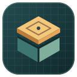

<p align="center">
  
</p>

# Blender Agent Skills

Build game assets and architectural scenes in Blender with your AI agent.

[**Install**](#install-in-a-project) · [**Previews**](#previews) · [**Copy a prompt**](#copy-ready-prompts) · [**Original bus prompt**](#original-bus-prompt) · [**Bus case study**](docs/case-studies/sugi-no-eki/README.md)

## Install in a project

From your project folder, run this and choose the skills and agent you want. The installer pulls the skills directly from this GitHub repo.

```sh
npx skills add vietlinhh02/blender-agent-skills
```

Install all three skills for **Antigravity CLI (AGY)** in one step:

```sh
npx skills add vietlinhh02/blender-agent-skills --skill "*" --agent antigravity-cli -y
```

Use **Node.js 22.20 or later** for the installer. Open a new agent session in your project after installing. To build a scene, give your agent access to Blender through the shell or a compatible Blender integration.

<details>
<summary>Install a single skill, target another agent, or install manually</summary>

```sh
npx skills add vietlinhh02/blender-agent-skills --list
npx skills add vietlinhh02/blender-agent-skills --skill blender-game-assets --agent codex
```

Use `claude-code`, `gemini-cli`, or `antigravity-cli` in place of `codex` to choose another client. Add `-g` to install for your user across projects. Install all three if you want the architecture workflow and prompt builder to find their sibling skills.

For manual installation, copy your selections from [skills/](skills/) into `.agents/skills/` for AGY, Codex, or Gemini CLI, or `.claude/skills/` for Claude Code. Keep each skill's folder and resources together.

[Installer documentation](https://github.com/vercel-labs/skills)

</details>

## Previews

### Stylized game workshop


Built with Codex following the game asset skill.

### Sugi no Eki bus terminal


**12-second bus animation**

https://github.com/user-attachments/assets/71eddd3d-d921-4d5f-a772-aa949c4d3848

[Download the original MP4](https://github.com/vietlinhh02/blender-agent-skills/releases/download/bus-case-study/sugi-no-eki-bus-stunt-12s.mp4) · [See the case study and token trace](docs/case-studies/sugi-no-eki/README.md)

## Pick a workflow

| Skill | Use it for |
| :--- | :--- |
| [**Blender Game Assets**](skills/blender-game-assets/SKILL.md) | Props, vehicles, rigged characters, creatures, and modular levels. Defaults to one agent, one small preview, and editable `.blend` plus engine export. |
| [**Architectural Environment Production**](skills/architectural-environment-production/SKILL.md) | Metric site plans, CAD/BIM or an orthographic fallback, six camera views, a cutaway, and a before/after sheet. |
| [**Architectural Prompt Builder**](skills/architectural-prompt-builder/SKILL.md) | Turn a building brief into a copy-ready prompt for the full architecture workflow. |

The architecture studio workflow was written for AGY and uses Blender MCP, image generation, and subagents. On another client, use equivalent tools when available.

## Copy-ready prompts

Copy a block into a session with its matching skill. Each example includes a concrete asset and deliverable so you can change the brief and reuse the rest.

### Utility rover

```text
Use blender-game-assets to build a stylized four-wheel maintenance rover for a top-down
exploration game. Keep the chassis, four wheels, two front steering pivots, and rear hatch
separate. Place pivots on the axles and on the hatch hinge. Add hatch_open and hatch_close
clips, then check the pivots and clip playback after exporting to .glb. Save the .blend
and provide one preview from the game camera. Leave driving behavior to the engine.
```

### Modular ruin kit

```text
Use blender-game-assets in blockout mode. Build a reusable ruin kit with one straight
wall, corner, doorway, floor tile, stair, and column. Snap everything to a 2 m grid and
use consistent origins. Assemble a small playable room in another collection to verify
the seams, doorway clearance, and stairs. Save the .blend with separate module and demo
collections and include one solid-view preview. Use flat colors for this pass.
```

<details>
<summary>Five more prompts for props, characters, creatures, and architecture</summary>

### Compact prop

```text
Use blender-game-assets to create a low-poly field radio for an isometric adventure game.
Give it a clear silhouette, a hinged battery cover, and a rubber antenna. Keep the body
under 1,500 triangles, use up to three material slots, and place the origin at the center
of its base. Keep the cover separate with its pivot on the hinge. Export one .blend and
one .glb, check that the cover can open without clipping, and show one gameplay-angle preview.
```

### Service robot

```text
Use blender-game-assets to create a knee-high stylized service robot with broad feet,
elbow joints, and a readable face. Use an armature with named bones and rigid weights
for the hard parts. Add loopable idle and walk clips plus a short wave. Check the poses
from the gameplay angle and re-import the .glb to verify the three clips. Deliver the
editable .blend, the .glb, and one preview.
```

### Cave beetle

```text
Use blender-game-assets to create an original, low-poly cave beetle companion for an
isometric game. Use six articulated legs, a rounded shell, and a bright marking that reads
against dark terrain. Rig the legs and flexible antennae. Make two 24 fps clips, idle and
scuttle, with clean loops and stable foot contact. Export .blend and .glb and provide one
preview from the gameplay camera.
```

### Courtyard conservatory

```text
Use architectural-environment-production and its full studio workflow to reconstruct a
botanical conservatory in Blender at 1 BU = 1 m. Include a glass entry vestibule, a 10 m by
16 m greenhouse, and a planted courtyard. Lock the structural grid, path widths, and roof
datums before massing. Use the skill's CAD/BIM pipeline or orthographic fallback, set
light direction for late-afternoon sun, and show the relationship between structural bays
and the glazing in Section A-A. Deliver the packed .blend, six camera views, and a
before/after progression sheet.
```

### Lighthouse brief

```text
Use architectural-prompt-builder to write a copy-ready master prompt for a compact
coastal lighthouse scene with a keeper's cottage, an exterior stair, and a rocky landing.
Use wet stone, white limewash, and an overcast blue-hour palette. Specify the zones and
camera priorities. Keep the output to the master prompt, ready to paste into
architectural-environment-production.
```

</details>

### Original bus prompt

This is the complete prompt used for the Sugi no Eki project. If you installed from this repo, replace `architectural_environment_production` with `architectural-environment-production` after copying. The full workflow uses four specialists and a shared Blender session.

```text
Build a complete multi-zone 3D architectural reconstruction of bus model  in Blender
    using the `architectural_environment_production` skill (OpenBIM + CAD Hybrid pipeline + Mandatory Studio Polish).

    Create a working folder `./arch_build_[slug]/` and follow all 6 stages strictly in metric scale (1 BU = 1m):

    0. **Stage 00 & 01 (OpenBIM + CAD Hybrid Blueprints & 1:1 BMesh Compilation)**:
       - Author `00_blueprints/spec.json` locking exact zone coordinates, real-world dimensions, structural grid, and Z-datum elevations.
       - Compile single-source-of-truth structural solids (`Manifold3D` + `IfcOpenShell` `.ifc` + `ezdxf` 4-panel ANSI31 section-hatched CAD blueprint `.dxf`/`.svg`/`.png` if installed, or pure Blender
       orthographic 4-panel fallback) and build 1:1 into organized Blender collections with `bmesh.ops.bisect_plane` horizontal Z-datum imprinting and `UVMap_Metric_1m` box projection.
       - Inspect solid massing and grounding (`get_scene_info` + `look`) before moving on.

    1. **Stage 02 (4-Tile Photorealistic Reference Contact Sheet & 5-Channel PBR Datums)**:
       - Generate a `16:9` 2x2 4-tile photorealistic reference contact sheet (`01_references/reference_contact_sheet_2x2.png`) matching the blueprint from 4 angles: (TL) Hero 3/4 exterior, (TR) Aerial site
       overview, (BL) Eye-level threshold/detail, (BR) Atmospheric courtyard/interior.
       - Inspect the contact sheet to lock proportions, silhouettes, lighting mood ([golden hour late afternoon sunlight filtering through cedar foliage]), and source 5-channel PBR textures mapped to
       `UVMap_Metric_1m`.

    2. **Stage 03 (4-Subagent Specialist Gauntlet Loop)**:
       - Spawn 4 parallel specialist subagents (`Model="inherit"`, one per reference domain: 1. Primary Architecture & Joinery, 2. Site Terrain & Hardscape, 3. Threshold Details, Props & Foliage, 4.
       LookDev, Studio Polish, Lighting & Cameras).
       - Each specialist must write an independent, idempotent zone Python script (`03_scripts/zone_01..04.py`) without calling `execute_blender_code` concurrently; the Master Orchestrator executes scripts
       sequentially in Blender and saves checkpoints.

    3. **Stage 04 (Adversarial Visual Critique Loop)**:
       - Capture "Before" baseline renders first (`04_renders/before_*.png`).
       - Run iterative critique passes comparing live Blender renders against `01_references/reference_contact_sheet_2x2.png`, fixing proportion, recessed opening depth, scale, grounding, and material
       contrast until reaching >= 8.5/10.

    4. **Mandatory Studio Polish (All 5 Blender-Native Visual Strengths)**:
       - Execute all 5 imperfection layers: (1) `Light_Gobo_Canopy` overhead dappled cutout + `light.use_nodes = True` procedural Emission noise (`Scale = 6.0`) on Area/Spot lights; (2) Roughness stacking
       (`ShaderNodeMix` `LINEAR_LIGHT`, `Factor = 0.28`) + `Pointiness` edge-wear & `AmbientOcclusion` crevice dirt; (3) Full-Frame 35mm physical cameras with DoF (`f/1.8?f/2.8`) & Focus Empties; (4)
       Micro-bevels + `ObjectInfo.Random` per-instance macro-variation; (5) Bounded `VolumeScatter` haze, `AgX` color management, and subtle Compositor `FOG_GLOW` + lens dispersion.

    5. **Stage 05 (6-Camera Cycles Showcase, World-Space BMesh Section A-A Cutaway & Progression Matrix)**:
       - Render 6 physical cameras (`Cam_01_Hero_3Q` through `Cam_06_Section_AA_Cutaway`) in Cycles, including a non-destructive world-space `bmesh.ops.bisect_plane` Section A-A cutaway with capped ANSI31
       45-degree hatched cut faces.
       - Stitch `05_deliverables/progression_matrix.png` (Before vs. After) and `05_deliverables/showcase_6cam_sheet.png`, visually verify both sheets, and save the final `.blend`.
```

[Bus prompt on its own page](docs/prompts/sugi-no-eki-original.md) ? [All prompts on their own page](docs/prompts/README.md)

---

Created by **[vietlinhh02](https://github.com/vietlinhh02)** ? [Preview watermark](skills/blender-game-assets/scripts/watermark_preview.py) ? [AGY trace helper](skills/blender-game-assets/references/agy-trace.md)
