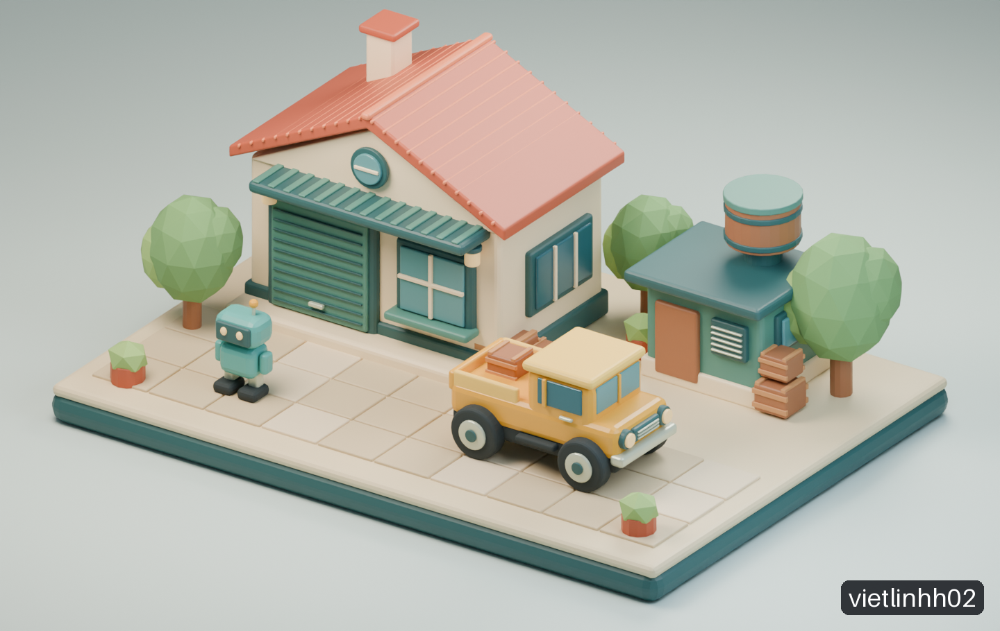

# Blender Agent Skills

Agent Skills for building game assets, playable scenes, and architectural environments in Blender. The game workflow uses one agent, one small preview, and one focused correction pass by default. The full architecture workflow adds CAD/BIM, materials, lighting, and presentation renders.



*Stylized game showcase made with Codex following the game asset skill and rendered in Blender.*

## Real Antigravity run

[](docs/case-studies/sugi-no-eki/)

[Sugi no Eki bus case study](docs/case-studies/sugi-no-eki/) documents a real `/teamwork` run with the original architecture skill. It includes the six camera views, progression, Blender source, animation, and token trace across 20 transcripts.

Credit: **vietlinhh02**. The optional preview script adds this credit to a separate PNG. You can set a different label with `--text`. The script only reads the preview image and writes the requested PNG.

## Included skills

- [blender-game-assets](skills/blender-game-assets/) builds and exports props, characters, vehicles, and environments for games.
- [architectural-environment-production](skills/architectural-environment-production/) contains the complete original architecture workflow. It includes the six studio stages, OpenBIM/CAD and shader references, the progression matrix script, and bilingual prompt templates.
- [architectural-prompt-builder](skills/architectural-prompt-builder/) turns a brief into a prompt for the studio workflow.

The full architecture workflow was written for Antigravity and uses Blender MCP and agent tools. On other clients, use the equivalent Blender, image, and agent tools if available. The game workflow can run with Blender and shell access.

The original local Antigravity skills used underscores in their names. The public folder names use hyphens to follow the Agent Skills specification. Their internal references and prompt examples use those public names.

## Install in a project

For game assets, copy the complete [blender-game-assets](skills/blender-game-assets/) folder into the location below. To install the full suite, copy **all three folders inside [skills](skills/)** as siblings under your client's skills directory. Start a new session in that project so the client can discover the skills.

| Client | Project location | Example |
| --- | --- | --- |
| Codex | `.agents/skills/blender-game-assets/` | `$blender-game-assets` |
| Antigravity (AGY) | `.agents/skills/blender-game-assets/` | `/blender-game-assets` |
| Gemini CLI | `.agents/skills/blender-game-assets/` | Ask it to use `blender-game-assets` |
| Claude Code | `.claude/skills/blender-game-assets/` | `/blender-game-assets` |

The core follows the [Agent Skills specification](https://agentskills.io/specification). Building requires local Blender through a shell or compatible integration. The agent's host controls tool access. Compatibility here refers to the skill format and discovery paths.

## Try it

> Use blender-game-assets to build a stylized mining cart for a low-poly game. Give the wheels separate pivots, save a .blend and export .glb. Deliver a small preview with credit.

To add the credit manually, install Pillow 10.1 or newer in your Python environment, then run:

```sh
python skills/blender-game-assets/scripts/watermark_preview.py preview.png preview-credited.png
```

Add `--text "Your studio" --font "/path/to/font.ttf"` to customize the label and font. For Antigravity CLI users, [token tracing](skills/blender-game-assets/references/agy-trace.md) is available as a separate tool.
