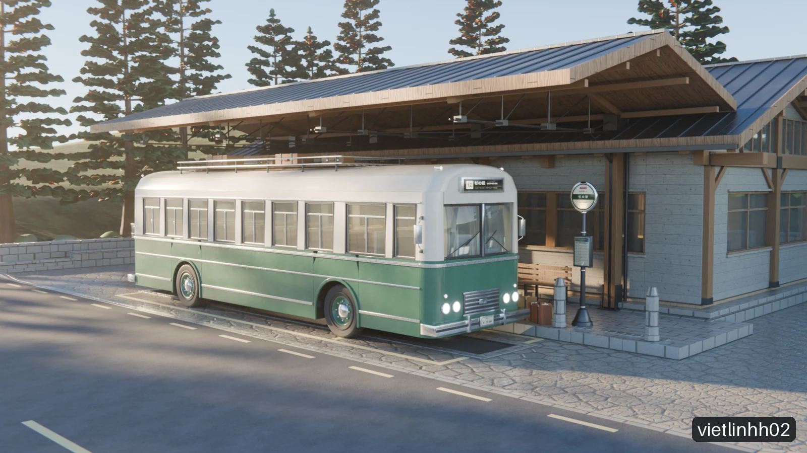

# Sugi no Eki bus terminal

This case study documents a real Antigravity CLI run from November 20, 2026. The user invoked `/teamwork` with the original `architectural_environment_production` skill. The project orchestrator's transcript records a read of that skill's `SKILL.md`, plus its OpenBIM/CAD and shader references. The full workflow is now available as [architectural-environment-production](../../../skills/architectural-environment-production/architecture-studio.md).

The bus case predates [blender-game-assets](../../../skills/blender-game-assets/SKILL.md) and serves as a measured baseline. The workshop image on the repository homepage is a separate Blender example made with Codex using the game skill's instructions.

## What the run produced

| Stage | Work |
| --- | --- |
| 00?01 | Site and scale specification, CAD/BIM drawings, and Blender blockout |
| 02 | Reference contact sheet and material maps |
| 03 | Bus structure, site and hardscape, details and foliage, lighting and cameras, then integration in Blender |
| 04 | Two visual critique passes with a refinement and integration pass |
| 05 | Six Cycles views, a cutaway, and a before/after presentation sheet |
| Follow-up | A short loop and a 12-second stunt animation from the same project |

- [Six original camera views](images/bus-showcase.webp)
- [Blockout-to-final progression](images/bus-progression.webp)
- [12-second animation keyframes](images/bus-animation.webp)
- [Download static Blender scene](https://github.com/vietlinhh02/blender-agent-skills/releases/download/bus-case-study/sugi-no-eki-bus-terminal.blend)
- [Download the 12-second MP4](https://github.com/vietlinhh02/blender-agent-skills/releases/download/bus-case-study/sugi-no-eki-bus-stunt-12s.mp4)

The downloadable `.blend` contains the static terminal and bus scene. It was reopened in Blender 5.2 with 1,190 objects, 54 packed images, and relative resource paths. The MP4 is the completed 12-second preview from the follow-up. A separate 1080p render attempt stopped after 41 PNG frames and reported a CUDA illegal-address error.

## Token breakdown

The [trace script](../../../skills/blender-game-assets/scripts/trace_agy.py) tallied 658 model-call records across 20 transcripts. Figures show input and output as recorded by AGY, with cache reads reported separately. This subtotal measures neither GPU render time nor the exact amount of an account's five-hour quota. The local transcript fields used here do not include a separate thinking token count. [AGY quota documentation](https://antigravity.google/docs/cli/commands/usage)

| Scope | Model calls | Input | Output | Input + output | Cache read |
| --- | ---: | ---: | ---: | ---: | ---: |
| Entire run, including follow-ups | 658 | 26,458,786 | 1,166,508 | **27,625,294** | 71,623,582 |
| Main conversation | 137 | 11,359,112 | 229,884 | 11,588,996 | 16,462,573 |
| Project orchestrator | 105 | 5,131,753 | 106,278 | 5,238,031 | 13,324,875 |
| Teamwork coordination conversation | 95 | 3,972,869 | 51,286 | 4,024,155 | 7,710,360 |

The three conversations above account for 20,851,182 input + output tokens, or 75.5% of the run. The main conversation includes animation and render follow-ups.

| Selected worker group | Input + output | Counting scope |
| --- | ---: | --- |
| Stage 03 build and integration | 2,941,989 | Four specialists and the integration worker |
| Stage 04 critique and refinement | 1,385,484 | Two critics and two refinement/integration workers |
| Stage 05 showcase and cutaway | 991,235 | Delivery worker |
| Stage 02 reference and materials | 339,302 | Reference and PBR worker |
| Stages 00?01 specification and blockout | 191,907 | Blueprint and massing worker |

These worker totals exclude time and tokens spent coordinating each stage in the main or orchestrator conversations. They are already included in the entire-run total.

| Main conversation hotspot | Model calls | Input + output |
| --- | ---: | ---: |
| Extend the stunt to 12 seconds and increase breakup detail | 33 | 4,799,772 |
| Add articulated parts and the stunt progression | 27 | 2,824,103 |
| Final `endtask` request, step #376 | 1 | 401,766 |

The final `endtask` call logged 401,214 input tokens and zero cache reads even though the request itself was short. This makes context size a practical measurement to track when moving from modeling to animation and render.

[Download the full aggregated trace](token-trace.txt) for every role, model, main user turn, and the ten largest calls. It contains counters and tool names. The original prompts, raw transcripts and local paths stay private.

## How to compare with the lighter workflow

Use the same modeling brief and runtime on a fresh run. Save the Blender scene at the end of modeling, then track preview and export in separate turns with `[phase: build]`, `[phase: preview]`, and `[phase: export]`. Compare model-call count, input/output, cache reads, and the resulting files. The game skill defaults to one agent and one small preview. This baseline does not measure the savings of the newer workflow.
